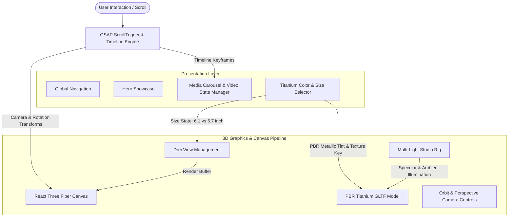

# iPhone 15 Pro — Interactive 3D Web Experience

[](https://react.dev/)
[](https://threejs.org/)
[](https://r3f.docs.pmnd.rs/)
[](https://greensock.com/)
[](https://tailwindcss.com/)
[](https://sentry.io/)
[](LICENSE)

An interactive 3D web experience replicating the visual fidelity and interaction design of Apple's **iPhone 15 Pro** announcement website. Built with **React 18**, **Three.js**, **React Three Fiber (R3F)**, **Drei**, and **GSAP ScrollTrigger**, the application showcases advanced WebGL rendering, physically based materials (PBR), dynamic lighting rigs, and timeline-synchronized device transitions.

---

## Architectural Blueprint

The application employs a dual-canvas render architecture decoupled from DOM scroll triggers, enabling simultaneous rendering of dual device form factors (6.1-inch Pro and 6.7-inch Pro Max) without recreation of WebGL shader contexts:



---

## Key Capabilities

### 1. Dual-View 3D Model Explorer
- **Zero-Stutter Device Scaling:** Instead of scaling meshes on the fly, the viewport renders two synchronized Drei `View` instances (`#view1` and `#view2`) inside a unified root WebGL canvas.
- **GSAP Coordinate Morphing:** Sliding between the 6.1" Pro and 6.7" Pro Max executes a coordinate transform `translateX(-100%)` with cubic bezier easing (`power2.inOut`), dynamically adjusting camera field-of-view and group rotation state.

### 2. Physically Based Rendering (PBR) Materials
- Real-time metallic material shading mapped across all four official aerospace-grade Titanium finishes:
  - **Natural Titanium:** `#8F8A81` base with champagne highlights.
  - **Blue Titanium:** `#535C68` deep sapphire anodized alloy.
  - **White Titanium:** `#C9C8C2` satin ceramic-infused reflection.
  - **Black Titanium:** `#454749` space-black brushed finish.

### 3. Studio Lighting Rig (`Lights.jsx`)
- Directional key and fill lights with soft penumbra falloff.
- Multi-point specular lights calibrated to bounce highlights off curved titanium chamfers.
- Ambient environmental fill ensuring deep shadows retain contrast without washing out specular highlights.

### 4. Interactive Media Carousel
- Timeline-driven carousel tracking video playback progress, buffer states, and automatic progression across key marketing sequences (A17 Pro architecture, telephoto optical zoom, and lightweight frame design).

### 5. Production Observability
- Integrated **Sentry React SDK** for real-time tracking of WebGL context losses, asset loading exceptions, and client framerate telemetry.

---

## Repository Structure

```
apple/
├── tests/
│   └── constants_and_pipeline.test.js  # Automated configuration & pipeline tests
├── public/                             # 3D assets, textures & video feeds
├── src/
│   ├── components/
│   │   ├── Model.jsx                   # Root 3D container & variant state
│   │   ├── ModelView.jsx               # Viewport canvas & camera rigging
│   │   ├── Iphone.jsx                  # GLTF mesh & material binding
│   │   ├── Lights.jsx                  # Studio lighting rig
│   │   ├── VideoCarousel.jsx           # Timeline media carousel
│   │   ├── Hero.jsx                    # Intro sequence with GSAP reveal
│   │   └── Features.jsx                # Architectural scroll highlights
│   ├── constants/                      # Finish colors, sizes & slide metadata
│   ├── utils/
│   │   └── animations.js               # GSAP timeline & scroll helpers
│   ├── App.jsx
│   └── main.jsx
├── .env.example
├── tailwind.config.js
└── vite.config.js
```

---

## Quickstart & Local Setup

### 1. Prerequisites
- Node.js 18+ (tested on Node v20/v22/v24)
- npm

### 2. Installation

```bash
# Clone the repository
git clone https://github.com/youcef-ach/apple.git
cd apple

# Install dependencies
npm install

# Setup environment configuration
cp .env.example .env

# Run automated tests
npm test

# Launch local development server
npm run dev
```

Visit `http://localhost:5173` to explore the 3D showcase.

### 3. Build for Production

```bash
npm run build
npm run preview
```

---

## Automated Test Suite

The test suite validates model metadata, hex palette integrity, scale constants, and viewport transform mathematics:

```bash
npm test
```
```
▶ Apple 3D Showcase Configuration & Data Integrity
  ✔ Navigation items contain required product links
  ✔ Model variants define four Titanium finishes with hex palettes
  ✔ Device sizes correctly declare 6.1 and 6.7 inch viewport scale modes
  ✔ Highlights carousel declares positive duration for each keyframe video
  ✔ 3D view transformation offsets ensure non-overlapping dual canvas layout
✔ Apple 3D Showcase Configuration & Data Integrity
ℹ tests 5
ℹ pass 5
ℹ fail 0
```

---

## License

This project is licensed under the MIT License — see the [LICENSE](LICENSE) file for details.
